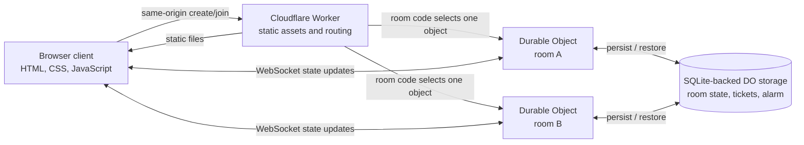

# Architecture and security notes

## Runtime architecture

Each room code maps to one Durable Object. That object is the authority for roster, readiness, phase, deadlines, assignments, submissions, shared clues, and votes. Its alarm advances timed phases and expires the room. The browser renders the state it receives; actions are sent back to the room server for validation.

## Information boundaries

| Data                         | During a round                                        | At reveal                                        |
| ---------------------------- | ----------------------------------------------------- | ------------------------------------------------ |
| Player roster and readiness  | Visible to the room                                   | Visible                                          |
| A player's role              | Only that player knows whether they are the Distorter | Distorter is named                               |
| Uninspected/unassigned clues | Kept by the server                                    | Not bulk disclosed                               |
| Inspected clues              | Visible only to the assigned player                   | Shared clues and canonical timeline are revealed |
| Vote targets                 | Hidden; only the vote count is projected              | Revealed                                         |
| Original shared-clue time    | Kept by the server                                    | Restored alongside any distorted display time    |

Every WebSocket state message is projected for its recipient. A player token is a bearer credential held in that tab's session storage; it is exchanged in a same-origin POST for a short-lived, single-use WebSocket ticket so the long-lived token is not put in the WebSocket URL. The WebSocket ticket is consumed atomically in the room's SQLite storage. Cross-origin WebSocket upgrades are refused.

The design protects against a modified client attempting to inspect other players' clues or submit invalid actions. It does not protect a player's device from local compromise or browser extensions. Avoid putting secrets or personal information in room chat.

## Scenario consistency

`src/scenarios.ts` is the source of truth for scenario definitions. Definitions are versioned and validated before a game starts. Assignment is reproducible from a server-generated room seed, while each player's clues, room view, anomaly, and timeline presentation are independently assigned. The server only gives an assigned clue to its owner after a valid room-object inspection.

## Retention and scope

- Rooms and their bearer sessions expire after 24 hours.
- Chat is transient room state and capped at the most recent 100 messages.
- There are no user accounts, analytics database, external AI calls, or paid inference dependencies.
- There is one playable scenario and no matchmaking, AI participants, voice, reports, or moderation queue.

## Operational risks and next steps

This is a small public game, not a high-abuse social platform. Room creation and chat do not yet have account-level identity, moderation tooling, or a distributed rate-limit service. Guest tokens are stored in `sessionStorage`, so a future cross-site scripting bug could expose the current session. If the game grows, add abuse controls, report/block flows, observability appropriate to the account plan, and a security review before enabling global matchmaking.

The repository CI runs the type check, scenario/room tests, and a Wrangler deployment dry run. It does not deploy production automatically.
